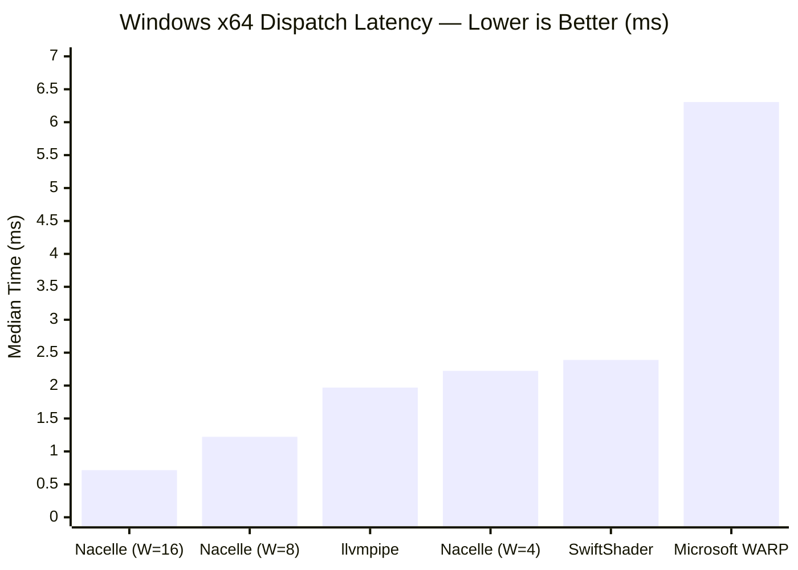
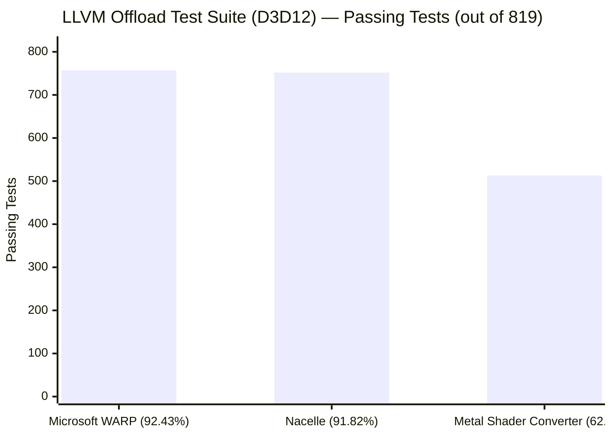
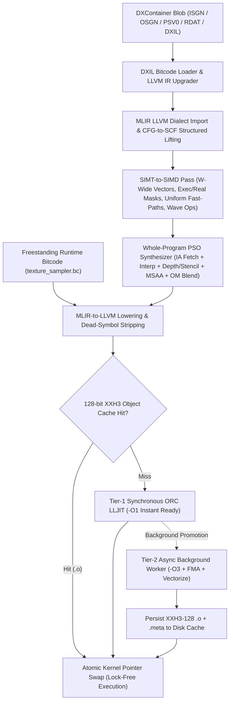
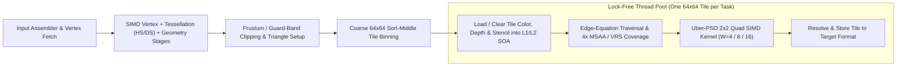

<div align="center">

# Nacelle

**A blisteringly fast, cross-platform Direct3D 12 & DXCore software GPU powered by MLIR and LLVM ORC JIT.**

[](https://github.com/farzonl/Nacelle/actions/workflows/ci.yml)
[](https://github.com/farzonl/Nacelle/actions/workflows/offload-compliance.yml)
[](https://github.com/farzonl/Nacelle/actions/workflows/windows-benchmark.yml)
[](https://farzonl.github.io/Nacelle/)
[](https://farzonl.github.io/Nacelle/)
[](#building-from-source)
[](#building-from-source)

[**Live Offload Compliance Dashboard**](https://farzonl.github.io/Nacelle/) · [**Live Cross-Rasterizer Benchmark Dashboard**](https://farzonl.github.io/Nacelle/bench.html)

</div>

---

## Overview

**Nacelle** is a ground-up, zero-compromise Direct3D 12 (`ID3D12Device`) and DXCore (`IDXCoreAdapterFactory`) software rasterizer and compute runtime for **Linux, macOS, and Windows**.

Instead of interpreting bytecode or translating shaders through lossy intermediate APIs (SPIR-V, Metal, or OpenGL), Nacelle ingests native **Shader Model 6.x DXIL** directly, lifts unstructured LLVM 3.7 bitcode into structured **MLIR**, packetizes scalar SIMT threads into wide host SIMD lanes (`AVX-512`, `AVX2`, `ARM64 NEON`), fuses fixed-function graphics state into monolithic **Uber-PSOs**, and JIT-compiles machine code via **LLVM ORC `LLJIT`**.

Whether used as a drop-in `D3D12CreateDevice` shared library (`libnacelle_d3d12`), a headless CI validation GPU, or an embedded rendering and compute engine, Nacelle delivers **WARP-level DirectX 12 conformance at speeds that leave traditional software rasterizers behind**.

---

## Unmatched Compliance & Unapologetic Performance

### 1. Faster Than WARP, llvmpipe, and SwiftShader

Software rendering has historically forced an ugly trade-off: accept slow execution for API fidelity (Microsoft WARP), or sacrifice D3D12 semantics by routing through Vulkan translation layers onto Mesa `llvmpipe` or Google `SwiftShader`.

**Nacelle breaks that trade-off—crushing Microsoft WARP, Mesa `llvmpipe`, and Google `SwiftShader`, and even approaching hardware GPU dispatch speeds on Apple Silicon:**

- **Up to 8.8x Faster than Microsoft WARP**: On Windows x64 (`bench_raymarch` 256×256, 48 steps), Nacelle (`W=16`) executes in **0.716 ms** median vs. **6.306 ms** on Microsoft WARP—while running natively across Linux, macOS, and Windows.
- **Up to 3.07x Faster than Mesa `llvmpipe` & 3.34x Faster than `SwiftShader`**:
  - **Windows x64**: **2.75x faster** than 256-bit `llvmpipe` (**0.716 ms** vs. **1.970 ms**) and **3.34x faster** than `SwiftShader` (**2.389 ms**)—even beating 256-bit `llvmpipe` head-to-head at matching `W=8` width (**1.222 ms**, **1.61x faster**).
  - **Linux ARM64 VM (4-vCPU NEON)**: **3.07x faster** than 128-bit `llvmpipe` (**1.286 ms** vs. **3.955 ms**), **3.24x faster** than `SwiftShader` (**4.168 ms**), and within **1.8x** of paravirtualized **Virtio-GPU Venus (`Apple M5` hardware GPU, `0.711 ms`)**—while host-native Apple M5 Nacelle (**0.630 ms**) actually *beats* Virtio-GPU Venus!
- **Hardware-GPU Territory on Apple M5**: On Apple Silicon (M5), Nacelle's pure-CPU SIMD runtime (**0.630 ms** median, **0.605 ms** min at `W=16`) runs **within ~7% of the Apple M5 hardware GPU** executing the same DXIL shader through Apple's Metal Shader Converter (**0.586 ms** median) or Mesa KosmicKrisp (**0.552 ms** median).
- **Zero Translation Tax & Whole-Program Uber-PSOs**: Consumes native DXContainer/DXIL directly—fusing input assembly, perspective-correct interpolation, depth/stencil, 4x MSAA, freestanding BCn texture sampling, and output-merger blending into L1/L2-resident `64x64` SOA tile kernels with background `-O3` FMA JIT promotion.

#### Measured Benchmark Results (`nacelle-bench`: 256×256 Raymarch Compute, 48 Steps)

**Windows x64 — Software Rasterizer / Compute Head-to-Head:**

| Backend | Shader Format | Compile (ms) | Median Dispatch (ms) | Min Dispatch (ms) | Speedup vs. WARP |
| :--- | :--- | ---: | ---: | ---: | :--- |
| **Nacelle (`W=16`)** | **DXIL** | **65.68** | **0.716** | **0.708** | **8.81x faster** |
| **Nacelle (`W=8`)** | **DXIL** | **50.62** | **1.222** | **1.132** | **5.16x faster** |
| **Nacelle (`W=4`)** | **DXIL** | **60.94** | **2.224** | **2.148** | **2.84x faster** |
| **Mesa `llvmpipe` (LLVM 23.1, 256-bit)** | SPIR-V | 2.30 | 1.970 | 1.944 | 3.20x faster |
| **Google `SwiftShader`** | SPIR-V | 31.57 | 2.389 | 2.345 | 2.64x faster |
| **Microsoft WARP** | DXIL | 4.17 | 6.306 | 6.080 | 1.00x (Baseline) |



**Linux ARM64 VM (4-vCPU NEON on Apple M5 Host) — Software & Virtio-GPU Head-to-Head:**

| Backend | Execution Device | Shader Format | Compile (ms) | Median Dispatch (ms) | Min Dispatch (ms) | Speedup vs. `SwiftShader` |
| :--- | :--- | :--- | ---: | ---: | ---: | :--- |
| **Vulkan (`venus`): Virtio-GPU Venus (Apple M5)** | Paravirt Host GPU | SPIR-V | 0.04 | 0.711 | 0.537 | 5.86x faster |
| **Nacelle (`W=16`)** | **CPU Software JIT** | **DXIL** | **0.33** *(warm)* | **1.286** | **1.268** | **3.24x faster** (**3.07x** vs. `llvmpipe`) |
| **Nacelle (`W=8`)** | **CPU Software JIT** | **DXIL** | **0.22** *(warm)* | **1.700** | **1.586** | **2.45x faster** (**2.33x** vs. `llvmpipe`) |
| **Nacelle (`W=4`)** | **CPU Software JIT** | **DXIL** | **5.77** *(warm)* | **2.542** | **2.259** | **1.64x faster** (**1.56x** vs. `llvmpipe`) |
| **Mesa `llvmpipe` (LLVM 20.1, 128-bit)** | CPU Software JIT | SPIR-V | 1.96 | 3.955 | 3.886 | 1.05x faster |
| **Google `SwiftShader`** | CPU Software JIT | SPIR-V | 34.84 | 4.168 | 3.363 | 1.00x (Baseline) |

**macOS (Apple M5) — Nacelle CPU Software GPU vs. Apple M5 Hardware GPU Drivers:**

| Backend | Execution Device | Shader Path | Median Dispatch (ms) | Min Dispatch (ms) | Output Checksum |
| :--- | :--- | :--- | ---: | ---: | ---: |
| **Vulkan (`MoltenVK`): Apple M5** | Hardware GPU | SPIR-V → MSL | 0.382 | 0.349 | `118136.20` |
| **Vulkan (`KosmicKrisp`): Apple M5** | Hardware GPU | SPIR-V → MSL | 0.552 | 0.352 | `118136.21` |
| **Metal (`IRConverter`): Apple M5** | Hardware GPU | DXIL → Metal IR | 0.586 | 0.550 | `118136.20` |
| **Nacelle (`W=16`)** | **CPU Software JIT** | **Native DXIL** | **0.630** | **0.605** | **`118136.20`** |
| **Nacelle (`W=8`)** | **CPU Software JIT** | **Native DXIL** | **0.907** | **0.824** | **`118136.20`** |
| **Nacelle (`W=4`)** | **CPU Software JIT** | **Native DXIL** | **1.180** | **1.096** | **`118136.20`** |

> [!TIP]
> Track continuous per-commit frame and dispatch timings of **Nacelle (`W=4`, `W=8`, `W=16`) vs. Microsoft WARP vs. Mesa llvmpipe vs. SwiftShader** on the [**Live Benchmark Dashboard**](https://farzonl.github.io/Nacelle/bench.html).

### 2. True D3D12 Target Fidelity — Crushing Translation Layers

When evaluated against the upstream [**LLVM Offload Test Suite**](https://github.com/llvm/offload-test-suite) (`OffloadTest-d3d12` — 819 end-to-end GPU execution tests exercising HLSL intrinsics, `fp16`/`fp64` math, 64-bit buffer atomics, wave intrinsics, inline raytracing (`RayQuery`), root signatures, raw/structured/typed buffers, and UAVs), **Nacelle achieves a 91.82% pass rate (752 passing tests)**.

That puts Nacelle **within 5 tests (0.61 percentage points) of Microsoft WARP's 92.43% (757 passing tests)—while running up to 8.8x faster than WARP and working across Linux, macOS, and Windows**—and **29.18 percentage points (+239 tests) ahead of Apple's Metal Shader Converter**, which passes only **513 tests (62.64%)** before hitting translation walls on D3D12 resource models, 64-bit operations, and wave semantics.

| D3D12 Execution Target | Execution Path | Host OS Support | Offload Suite Passed | Pass Rate | Throughput vs. WARP |
| :--- | :--- | :--- | ---: | ---: | :--- |
| **Nacelle** | **Native DXIL → MLIR → Host SIMD JIT** | **Linux, macOS, Windows** | **752 / 819** | **91.82%** | **Up to 8.81x Faster** |
| **Microsoft WARP** | Native DXIL → CPU JIT | Windows only | 757 / 819 | 92.43% | 1.00x (Baseline) |
| **Apple Metal Shader Converter** | DXIL → Metal IR Translation | macOS only | 513 / 819 | 62.64% | N/A (239 fewer passing tests) |



---

## Software Architecture

Nacelle is structured into three tightly integrated subsystems: a zero-overhead **D3D12 / DXCore COM API Frontend**, an **MLIR + LLVM Whole-Program SIMT-to-SIMD Compiler**, and a **Multi-Threaded Sort-Middle Tile Rasterizer & Compute Engine**.

### High-Level System Overview

```mermaid
flowchart LR
    subgraph App["Application / Test Harness"]
        HLSL["HLSL via DXC (SM 6.x DXIL)"]
        D3DApp["D3D12 / DXCore Client"]
    end

    subgraph API["D3D12 & DXCore Runtime (src/api)"]
        DXCore["DXCore Adapter Factory"]
        Device["ID3D12Device & Heaps"]
        RootSig["Root Signature & Descriptors"]
        CmdList["Command List Recording"]
        Queue["Command Queue & Fences"]
    end

    subgraph Compiler["MLIR + LLVM ORC Compiler (src/compiler)"]
        Loader["DXContainer & DXIL Upgrader"]
        MLIR["MLIR CFG-to-SCF Lifter"]
        Packetizer["SIMT-to-SIMD Packetizer (W=4/8/16)"]
        UberPSO["Uber-PSO State Synthesizer"]
        JIT["Dual-Tier ORC LLJIT + XXH3 Cache"]
    end

    subgraph Exec["Parallel Execution Engine (src/rasterizer)"]
        Compute["Multi-Wave SIMD Compute Dispatcher"]
        Geom["SIMD VS / HS / DS / GS & Clipping"]
        Binner["64x64 Sort-Middle Tile Binner"]
        Quads["2x2 Quad SOA Tile Rasterizer"]
    end

    HLSL --> Device
    D3DApp --> DXCore --> Device
    D3DApp --> RootSig & CmdList & Queue
    Device --> Loader --> MLIR --> Packetizer --> UberPSO --> JIT
    CmdList --> Queue
    Queue --> Compute & Geom
    JIT -. "Native Function Pointers" .-> Compute & Geom & Quads
    Geom --> Binner --> Quads
```



### Compiler Pipeline: From Scalar DXIL to Wide Host SIMD

DXIL is frozen on legacy LLVM 3.7 bitcode with scalar per-thread semantics (`@dx.op.*` intrinsics). Nacelle upgrades DXIL bitcode in-memory to modern LLVM IR, imports it into MLIR, reconstructs structured `scf.if` / `scf.while` control flow, and vectorizes across `W` SIMT lanes simultaneously—fusing freestanding LLVM bitcode routines (`texture_sampler.bc`) directly into the compiled kernel so texture sampling and BCn block decompression inline into vector loops.



### Sort-Middle `64x64` Tile Graphics Pipeline

To maximize cache locality and eliminate memory bandwidth bottlenecks, Nacelle never touches row-major system memory during per-pixel shading. Geometry is transformed in SIMD batches, clipped against guard-band planes, and binned into `64x64` screen tiles. Worker threads claim independent tiles with zero lock contention, shading `2x2` pixel quads packed into `W`-wide SIMD vectors directly against tile-local SOA buffers.



---

## Key Capabilities

- **Drop-In D3D12 & DXCore ABI**: Exports standard `D3D12CreateDevice`, `DXCoreCreateAdapterFactory`, `D3D12SerializeRootSignature`, `D3D12SerializeVersionedRootSignature`, and `D3D12GetDebugInterface` symbols (`nacelle_d3d12.dll` / `libnacelle_d3d12.so` / `libnacelle_d3d12.dylib`), alongside explicit `Nacelle*` C entry points for static linking.
- **Full Programmable Graphics & Compute Pipeline**:
  - Compute (`cs_6_x`) with multi-wave threadgroups, `groupshared` memory barriers, and full SM 6.0+ wave intrinsics (`WaveActiveSum`, `WaveActiveMin`/`Max`, `WavePrefix*`, `WaveReadLane*`, `QuadRead*`).
  - Vertex (`vs_6_x`), Hull (`hs_6_x`), Domain (`ds_6_x`), Geometry (`gs_6_x`), and Pixel (`ps_6_x`) stages.
  - **DXR 1.1 Inline Raytracing (`RayQuery`)**: Bottom-level and top-level BVH acceleration structure builds (`BuildRaytracingAccelerationStructure`) and hardware-free SM 6.5+ `RayQuery` traversal (**100% pass rate** on Offload `Feature/InlineRT`).
  - **Tier-3 Tiled / Reserved Resources**: Sparse 64 KiB page-table backing (`CreateReservedResource`, `UpdateTileMappings`, `CopyTiles`) and `CheckAccessFullyMapped` shader residency feedback.
  - Variable Rate Shading (VRS), 4x MSAA, SV_Barycentrics, `SV_ClipDistance` / `SV_CullDistance`, `SV_ViewportArrayIndex`, independent blend states, depth/stencil bounds, and BC1–BC7 compressed textures.
- **Persistent 128-bit XXH3 PSO Disk Cache**: Hashes compiler build stamp, DXIL bytecode, Root Signature layout, and fixed-function PSO state into deterministic `.o` object artifacts for sub-millisecond warm startup.

---

## Building from Source

### Prerequisites

- **CMake** `>= 3.24` and **Ninja**
- **C++20** compiler (`Clang`, `GCC`, or `MSVC`)
- **LLVM & MLIR** (built with `LLVM_ENABLE_PROJECTS="mlir;clang"` and host target enabled; Homebrew `llvm` is auto-detected on macOS)
- **DirectXShaderCompiler (`dxc`)** (for compiling HLSL test and benchmark shaders)
- Optional: **SDL3** (enables interactive windowed mode in `nacelle_viewer`; automatically fetched on Windows)

### Clone & Build

```bash
git clone https://github.com/farzonl/Nacelle.git
cd Nacelle

# Initialize core submodules
git submodule update --init --depth 1 \
  third_party/DirectX-Headers \
  third_party/DirectXMath \
  third_party/bcdec \
  third_party/thread-pool \
  third_party/xxHash

# Configure & build (point LLVM_DIR / MLIR_DIR to your LLVM/MLIR install if not on system path)
cmake -S . -B build -G Ninja \
  -DCMAKE_BUILD_TYPE=Release \
  -DLLVM_DIR=/path/to/llvm/lib/cmake/llvm \
  -DMLIR_DIR=/path/to/llvm/lib/cmake/mlir

cmake --build build --parallel

# Run the test suite
ctest --test-dir build --output-on-failure
```

---

## Command-Line Tools & Viewer

| Target | Description |
| :--- | :--- |
| `libnacelle` / `nacelle_d3d12` | Static library and drop-in shared D3D12/DXCore runtime (`D3D12CreateDevice`, `DXCoreCreateAdapterFactory`). |
| `nacelle-compile` | Standalone AOT/inspection compiler CLI—compiles `.dxil` compute or VS+PS pipelines and dumps lifted SCF MLIR (`--emit-scf`), packetized SIMD MLIR (`--emit-simd-mlir`), or linked LLVM IR (`--emit-llvm`). |
| `nacelle-bench` | Head-to-head benchmark harness comparing Nacelle (`W=4`, `W=8`, `W=16`) against Microsoft WARP, Mesa `llvmpipe`, Google `SwiftShader`, and Apple Metal Shader Converter with output checksum verification. |
| `nacelle_viewer` | Interactive SDL3 + headless D3D12 sample viewer with swapchain presentation callbacks. |

### Inspecting Generated MLIR & SIMD IR

```bash
# Inspect lifted structured SCF MLIR and wide AVX2/AVX-512 packetized MLIR for a DXIL compute shader
./build/nacelle-compile --cs build/tests/shaders/bench_raymarch.dxil --simd-width=8 --emit-scf --emit-simd-mlir

# Run cross-backend raymarching benchmarks across SIMD widths and rival software rasterizers
./build/nacelle-bench --iters 7 --json bench-results.json
```

---

## Repository Layout

```text
Nacelle/
├── include/nacelle/       # Public C/C++ D3D12, DXCore & swapchain presentation headers
├── src/
│   ├── api/               # COM runtime: Device, CommandList, RootSignature, Heaps, DXCore
│   ├── compiler/          # DXIL upgrader, MLIR lifter, SIMT-to-SIMD pass, Uber-PSO & ORC LLJIT
│   ├── rasterizer/        # SIMD geometry pipe, 64x64 sort-middle tile binner & quad rasterizer
│   ├── runtime_bc/        # Freestanding C++20 texture sampler compiled to embedded LLVM bitcode
│   └── common/            # Format conversion, FP environment & POSIX SAL compatibility
├── tools/                 # nacelle-compile & nacelle-bench cross-rasterizer benchmark suite
├── apps/                  # nacelle_viewer (interactive SDL3 + headless D3D12 app)
├── pages/                 # Live GitHub Pages dashboards (Offload compliance & benchmarks)
└── tests/                 # Unit, compiler FileCheck, rendering, and D3D12 conformance tests
```
