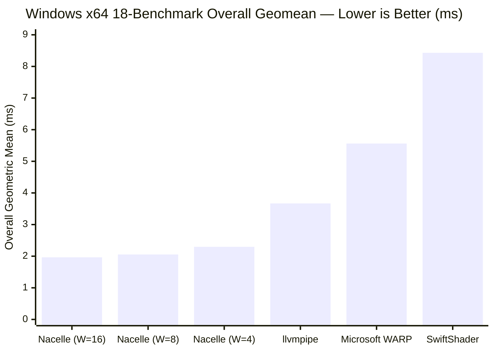
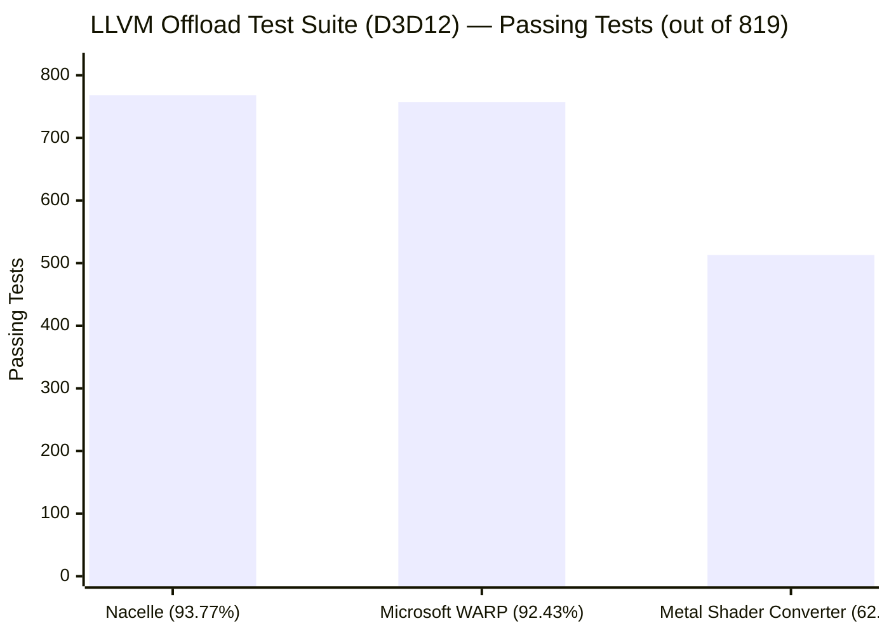
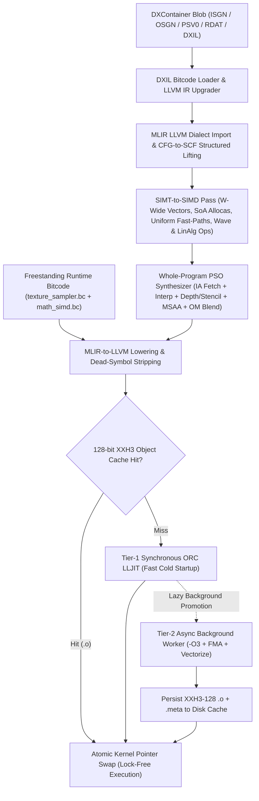
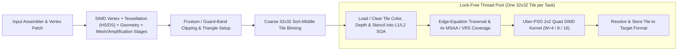

<div align="center">

# Nacelle

**A blisteringly fast, cross-platform Direct3D 12 & DXCore software GPU powered by MLIR and LLVM ORC JIT.**

[](https://github.com/farzonl/Nacelle/actions/workflows/ci.yml)
[](https://github.com/farzonl/Nacelle/actions/workflows/offload-compliance.yml)
[](https://github.com/farzonl/Nacelle/actions/workflows/windows-benchmark.yml)
[](https://github.com/farzonl/Nacelle/actions/workflows/macos-benchmark.yml)
[](https://farzonl.github.io/Nacelle/)
[](https://farzonl.github.io/Nacelle/)
[](#building-from-source)
[](#building-from-source)

[**Live Offload Compliance Dashboard**](https://farzonl.github.io/Nacelle/) · [**Live Cross-Rasterizer Benchmark Dashboard**](https://farzonl.github.io/Nacelle/bench.html)

</div>

---

## Overview

Optional [offline shader/runtime profiling](tools/nacelle-dbg/README.md) provides
local `.nacelle-profile` capture, Chrome Trace export, and a
[static profile viewer](tools/nacelle-view/README.md). Instrumentation is OFF by
default. Separately consented [compute/buffer replay](tools/nacelle-replay/README.md)
supports same-environment, fresh-state output checks. Opt-in
[native shader debugging with LLDB](tools/nacelle-dbg/README.md#native-shader-debugging-lldb)
supports Linux x86_64 instruction breakpoints, stepping and frames.
Separately consented [HLSL source/lane debugging](tools/nacelle-dbg/README.md#hlsl-source-and-lane-inspection-linux-x86_64-lldb)
supports pinned O0 and separately opted-in optimized compute/pixel breakpoints,
stepping and scalar locals without independently executing selected lanes.
Optimized mode preserves asynchronous promotion and reports missing values or
imprecise mappings explicitly. Graphics replay and differential testing are
not yet included.

**Nacelle** is a ground-up, zero-compromise Direct3D 12 (`ID3D12Device`) and DXCore (`IDXCoreAdapterFactory`) software rasterizer and compute runtime for **Linux, macOS, and Windows**.

Instead of interpreting bytecode or translating shaders through lossy intermediate APIs (SPIR-V, Metal, or OpenGL), Nacelle ingests native **Shader Model 6.x DXIL** directly, lifts unstructured LLVM 3.7 bitcode into structured **MLIR**, packetizes scalar SIMT threads into wide host SIMD lanes (`AVX-512`, `AVX2`, `ARM64 NEON`), fuses fixed-function graphics state into monolithic **Uber-PSOs**, and JIT-compiles machine code via **LLVM ORC `LLJIT`**.

Whether used as a drop-in `D3D12CreateDevice` shared library (`libnacelle_d3d12`), a headless CI validation GPU, or an embedded rendering and compute engine, Nacelle delivers **WARP-level DirectX 12 conformance at speeds that leave traditional software rasterizers behind**.

---

## Unmatched Compliance & Unapologetic Performance

### 1. Faster Than WARP, llvmpipe, and SwiftShader

Software rendering has historically forced an ugly trade-off: accept slow execution for API fidelity (Microsoft WARP), or sacrifice D3D12 semantics by routing through Vulkan translation layers onto Mesa `llvmpipe` or Google `SwiftShader`.

**Nacelle breaks that trade-off—winning overall across an 18-benchmark multi-stage suite on Windows x64 against Microsoft WARP, Mesa `llvmpipe`, and Google `SwiftShader`, and even approaching hardware GPU dispatch speeds on Apple Silicon:**

- **#1 Overall Across 18 Multi-Stage Benchmarks (Windows x64)**: Across Compute, Vertex, Pixel, Geometry, Tessellation, and Ray Tracing workloads, **Nacelle (`W=16`) achieves an overall geometric mean of `1.964 ms`**—**2.83x faster** than **Microsoft WARP (`5.563 ms`)**, **1.87x faster** than **Mesa `llvmpipe` 256-bit (`3.669 ms`)**, and **4.29x faster** than **Google `SwiftShader` (`8.430 ms`)**.
- **Category & Regime Dominance**: Nacelle leads **Compute** (`0.782 ms` geomean), **Vertex** (`6.636 ms` geomean at `W=8`), and **Ray Tracing** (`0.078 ms` geomean at `W=4`), as well as the **Hot JIT** (`1.824 ms`), **Short-Running Job** (`0.495 ms`), and **Long-Running Job** (`6.780 ms`) regimes.
- **Up to 142x Faster Ray Tracing & 7.95x Faster Tessellation than WARP**: On Windows x64, Nacelle executes `DispatchRays` in **`0.071 ms`** (vs. `10.131 ms` WARP / `1.337 ms` `llvmpipe`), `RayQuery` in **`0.085 ms`** (vs. `2.696 ms` WARP / `3.571 ms` `llvmpipe`), and `VS+HS+DS+PS` tessellation in **`2.473 ms`** (vs. `19.659 ms` WARP).
- **SM 6.10 Linear Algebra (`LinAlg` / Cooperative Matrix)**: Nacelle executes 128×128 Cooperative Matrix GEMM in **`0.551 ms`** median (`0.497 ms` min at `W=16`) on Windows x64 (with Apple Accelerate / AMX acceleration on macOS), where Microsoft WARP fails `CreateComputePipelineState`.
- **Up to 3.07x Faster than `llvmpipe` & Hardware-GPU Territory on Apple Silicon**:
  - **Linux ARM64 VM (4-vCPU NEON, `bench_raymarch`)**: **3.07x faster** than 128-bit `llvmpipe` (**1.286 ms** vs. **3.955 ms**), **3.24x faster** than `SwiftShader` (**4.168 ms**), and within **1.8x** of paravirtualized **Virtio-GPU Venus (`Apple M5` hardware GPU, `0.711 ms`)**.
  - **macOS (Apple M5, `bench_raymarch`)**: Nacelle's pure-CPU SIMD runtime (**0.630 ms** median, **0.605 ms** min at `W=16`) runs **within ~7% of the Apple M5 hardware GPU** executing the same DXIL shader through Apple's Metal Shader Converter (**0.586 ms** median) or Mesa KosmicKrisp (**0.552 ms** median).
- **Zero Translation Tax & Whole-Program Uber-PSOs**: Consumes native DXContainer/DXIL directly—fusing input assembly, perspective-correct interpolation, depth/stencil, 4x MSAA, freestanding BCn texture sampling (`texture_sampler.bc`), and SIMD transcendental math (`math_simd.bc`) into L1/L2-resident `32x32` SOA tile kernels with background `-O3` FMA JIT promotion.

#### Windows x64 — 18-Benchmark Multi-Stage Suite (Overall & Highlights)

**Overall Geometric Mean Across All 18 Benchmarks (Lower is Better):**

| Backend | Overall Geomean (ms) | Speedup vs. WARP | Compute Geomean (ms) | Vertex Geomean (ms) | Ray Tracing Geomean (ms) |
| :--- | ---: | :--- | ---: | ---: | ---: |
| **Nacelle (`W=16`)** | **1.964** | **2.83x faster** | **0.782** | 6.727 | 0.085 |
| **Nacelle (`W=8`)** | **2.053** | **2.71x faster** | 0.875 | **6.636** | 0.084 |
| **Nacelle (`W=4`)** | **2.297** | **2.42x faster** | 1.174 | 7.166 | **0.078** |
| **Mesa `llvmpipe` (LLVM 23.1, 256-bit)** | 3.669 | 1.52x faster | 1.519 | 11.132 | 2.185 |
| **Microsoft WARP** | 5.563 | 1.00x (Baseline) | 1.981 | 6.647 | 5.226 |
| **Google `SwiftShader` (LLVM 10.0)** | 8.430 | 0.66x | 1.384 | 6.834 | *Unsupported* |



**Selected Workload Median Dispatch Latencies on Windows x64 (ms — Lower is Better):**

| Benchmark | Category | Nacelle (`W=16`) | Nacelle (`W=8`) | Microsoft WARP | Mesa `llvmpipe` | `SwiftShader` |
| :--- | :--- | ---: | ---: | ---: | ---: | ---: |
| **Raymarcher (ALU+CF)** | Compute | **1.562** | 1.947 | 8.389 | 3.134 | 3.018 |
| **LinAlg MatMul 128×128 (CoopMat)** | Compute | **0.551** | 0.995 | *Failed* | *N/A* | *N/A* |
| **Prefix Sum (Groupshared)** | Compute | **0.377** | 0.385 | 0.433 | 0.699 | 2.416 |
| **Wave Intrinsics (Subgroup)** | Compute | 0.236 | **0.228** | 0.369 | 0.312 | 0.415 |
| **Skinned Mesh (VB+IB+Cull)** | Vertex | 17.476 | **17.278** | 23.430 | 36.626 | 33.214 |
| **Light Cycle** | Pixel | **17.289** | 21.118 | 28.774 | 19.333 | 75.821 |
| **Tessellation (VS+HS+DS+PS)** | Tessellation | 2.504 | 2.487 | 19.659 | 3.082 | *Skipped* |
| **RayTracing Inline (`RayQuery`)** | Ray Tracing | 0.087 | **0.085** | 2.696 | 3.571 | *Skipped* |
| **RayTracing Pipeline (`DispatchRays`)** | Ray Tracing | 0.084 | **0.083** *(W=4: 0.071)* | 10.131 | 1.337 | *Skipped* |

**Linux ARM64 VM (4-vCPU NEON on Apple M5 Host) — `bench_raymarch` (256×256, 48 Steps):**

| Backend | Execution Device | Shader Format | Compile (ms) | Median Dispatch (ms) | Min Dispatch (ms) | Speedup vs. `SwiftShader` |
| :--- | :--- | :--- | ---: | ---: | ---: | :--- |
| **Vulkan (`venus`): Virtio-GPU Venus (Apple M5)** | Paravirt Host GPU | SPIR-V | 0.04 | 0.711 | 0.537 | 5.86x faster |
| **Nacelle (`W=16`)** | **CPU Software JIT** | **DXIL** | **0.33** *(warm)* | **1.286** | **1.268** | **3.24x faster** (**3.07x** vs. `llvmpipe`) |
| **Nacelle (`W=8`)** | **CPU Software JIT** | **DXIL** | **0.22** *(warm)* | **1.700** | **1.586** | **2.45x faster** (**2.33x** vs. `llvmpipe`) |
| **Nacelle (`W=4`)** | **CPU Software JIT** | **DXIL** | **5.77** *(warm)* | **2.542** | **2.259** | **1.64x faster** (**1.56x** vs. `llvmpipe`) |
| **Mesa `llvmpipe` (LLVM 20.1, 128-bit)** | CPU Software JIT | SPIR-V | 1.96 | 3.955 | 3.886 | 1.05x faster |
| **Google `SwiftShader`** | CPU Software JIT | SPIR-V | 34.84 | 4.168 | 3.363 | 1.00x (Baseline) |

**macOS (Apple M5) — `bench_raymarch` (256×256, 48 Steps) vs. Apple M5 Hardware GPU Drivers:**

| Backend | Execution Device | Shader Path | Median Dispatch (ms) | Min Dispatch (ms) | Output Checksum |
| :--- | :--- | :--- | ---: | ---: | ---: |
| **Vulkan (`MoltenVK`): Apple M5** | Hardware GPU | SPIR-V → MSL | 0.382 | 0.349 | `118136.20` |
| **Vulkan (`KosmicKrisp`): Apple M5** | Hardware GPU | SPIR-V → MSL | 0.552 | 0.352 | `118136.21` |
| **Metal (`IRConverter`): Apple M5** | Hardware GPU | DXIL → Metal IR | 0.586 | 0.550 | `118136.20` |
| **Nacelle (`W=16`)** | **CPU Software JIT** | **Native DXIL** | **0.630** | **0.605** | **`118136.20`** |
| **Nacelle (`W=8`)** | **CPU Software JIT** | **Native DXIL** | **0.907** | **0.824** | **`118136.20`** |
| **Nacelle (`W=4`)** | **CPU Software JIT** | **Native DXIL** | **1.180** | **1.096** | **`118136.20`** |

> [!TIP]
> Track continuous per-commit frame and dispatch timings of **Nacelle (`W=4`, `W=8`, `W=16`) vs. Microsoft WARP vs. Mesa llvmpipe vs. SwiftShader** across all 18 benchmarks on the [**Live Benchmark Dashboard**](https://farzonl.github.io/Nacelle/bench.html).

### 2. True D3D12 Target Fidelity — Surpassing Microsoft WARP

When evaluated against the upstream [**LLVM Offload Test Suite**](https://github.com/llvm/offload-test-suite) (`OffloadTest-d3d12` — 819 end-to-end GPU execution tests exercising HLSL intrinsics, `fp16`/`fp64` math, 64-bit buffer atomics, wave intrinsics, inline raytracing (`RayQuery`), root signatures, raw/structured/typed buffers, and UAVs), **Nacelle achieves a 93.77% pass rate (768 passing tests, 0 failures across all 772 executed D3D12 tests, 4 xfail, 47 unsupported Vulkan-specific tests)**.

That puts Nacelle **11 tests (+1.34 percentage points) ahead of Microsoft WARP's 92.43% (757 passing tests)—while running up to 2.83x faster overall than WARP and working across Linux, macOS, and Windows**—and **31.13 percentage points (+255 tests) ahead of Apple's Metal Shader Converter**, which passes only **513 tests (62.64%)** before hitting translation walls on D3D12 resource models, 64-bit operations, and wave semantics.

| D3D12 Execution Target | Execution Path | Host OS Support | Offload Suite Passed | Pass Rate | Overall Throughput vs. WARP |
| :--- | :--- | :--- | ---: | ---: | :--- |
| **Nacelle** | **Native DXIL → MLIR → Host SIMD JIT** | **Linux, macOS, Windows** | **768 / 819** | **93.77%** | **2.83x Faster (18-Bench Geomean)** |
| **Microsoft WARP** | Native DXIL → CPU JIT | Windows only | 757 / 819 | 92.43% | 1.00x (Baseline) |
| **Apple Metal Shader Converter** | DXIL → Metal IR Translation | macOS only | 513 / 819 | 62.64% | N/A (255 fewer passing tests) |



---

## Software Architecture

Nacelle is structured into three tightly integrated subsystems: a zero-overhead **D3D12 / DXCore COM API Frontend**, an **MLIR + LLVM Whole-Program SIMT-to-SIMD Compiler**, and a **Multi-Threaded Sort-Middle Tile Rasterizer & Compute Engine**.

### High-Level System Overview

```mermaid
flowchart LR
    subgraph App["Application / Test Harness"]
        HLSL["HLSL via DXC (SM 6.x DXIL)"]
        D3DApp["D3D12 / DXCore Client"]
    end

    subgraph API["D3D12 & DXCore Runtime (src/api)"]
        DXCore["DXCore Adapter Factory"]
        Device["ID3D12Device & Heaps"]
        RootSig["Root Signature & Descriptors"]
        CmdList["Command List Recording"]
        Queue["Command Queue & Fences"]
    end

    subgraph Compiler["MLIR + LLVM ORC Compiler (src/compiler)"]
        Loader["DXContainer & DXIL Upgrader"]
        MLIR["MLIR CFG-to-SCF Lifter"]
        Packetizer["SIMT-to-SIMD Packetizer (W=4/8/16)"]
        UberPSO["Uber-PSO State Synthesizer"]
        JIT["Dual-Tier ORC LLJIT + XXH3 Cache"]
    end

    subgraph Exec["Parallel Execution Engine (src/rasterizer)"]
        Compute["Multi-Wave SIMD Compute Dispatcher"]
        Geom["SIMD VS / HS / DS / GS / MS & Clipping"]
        Binner["32x32 Sort-Middle Tile Binner"]
        Quads["2x2 Quad SOA Tile Rasterizer"]
    end

    HLSL --> Device
    D3DApp --> DXCore --> Device
    D3DApp --> RootSig & CmdList & Queue
    Device --> Loader --> MLIR --> Packetizer --> UberPSO --> JIT
    CmdList --> Queue
    Queue --> Compute & Geom
    JIT -. "Native Function Pointers" .-> Compute & Geom & Quads
    Geom --> Binner --> Quads
```



### Compiler Pipeline: From Scalar DXIL to Wide Host SIMD

DXIL is frozen on legacy LLVM 3.7 bitcode with scalar per-thread semantics (`@dx.op.*` intrinsics). Nacelle upgrades DXIL bitcode in-memory to modern LLVM IR, imports it into MLIR, reconstructs structured `scf.if` / `scf.while` control flow, and vectorizes across `W` SIMT lanes simultaneously—fusing freestanding LLVM bitcode routines (`texture_sampler.bc` and `math_simd.bc`) directly into the compiled kernel so texture sampling, BCn block decompression, and FMA-contracted SIMD transcendental math inline into vector loops.



### Sort-Middle `32x32` Tile Graphics Pipeline

To maximize cache locality and eliminate memory bandwidth bottlenecks, Nacelle never touches row-major system memory during per-pixel shading. Geometry is transformed in SIMD batches, clipped against guard-band planes, and binned into `32x32` screen tiles. Worker threads claim independent tiles with zero lock contention, shading batched `2x2` pixel quads packed into `W`-wide SIMD vectors directly against tile-local SOA buffers (skipping destination loads on opaque covered tiles).



---

## Key Capabilities

- **Drop-In D3D12 & DXCore ABI**: Exports standard `D3D12CreateDevice`, `DXCoreCreateAdapterFactory`, `D3D12SerializeRootSignature`, `D3D12SerializeVersionedRootSignature`, and `D3D12GetDebugInterface` symbols (`nacelle_d3d12.dll` / `libnacelle_d3d12.so` / `libnacelle_d3d12.dylib`), alongside explicit `Nacelle*` C entry points for static linking.
- **Full Programmable Graphics, Compute & Raytracing Pipeline**:
  - Compute (`cs_6_x`) with multi-wave threadgroups, `groupshared` memory barriers, and full SM 6.0+ wave intrinsics (`WaveActiveSum`, `WaveActiveMin`/`Max`, `WavePrefix*`, `WaveReadLane*`, `QuadRead*`).
  - **SM 6.10 Linear Algebra (`LinAlg` / Cooperative Matrix)**: Hardware-free Cooperative Matrix vector/matrix operations and GEMM, accelerated via **Apple Accelerate / AMX** on macOS and optimized AOT GEMM fallbacks on Linux/Windows.
  - Vertex (`vs_6_x`), Hull (`hs_6_x`), Domain (`ds_6_x`), Geometry (`gs_6_x`), **Amplification (`as_6_5`)**, **Mesh (`ms_6_5`)**, and Pixel (`ps_6_x`) stages.
  - **DXR 1.0/1.1 Raytracing (`DispatchRays` & `RayQuery`)**: Bottom-level and top-level BVH acceleration structure builds (`BuildRaytracingAccelerationStructure`), full state-object raytracing pipelines (`DispatchRays`), and hardware-free SM 6.5+ `RayQuery` traversal (**100% pass rate** on Offload `Feature/InlineRT`).
  - **Tier-3 Tiled / Reserved Resources**: Sparse 64 KiB page-table backing (`CreateReservedResource`, `UpdateTileMappings`, `CopyTiles`) and `CheckAccessFullyMapped` shader residency feedback.
  - Variable Rate Shading (VRS), 4x MSAA, `SV_Barycentrics`, `SV_ClipDistance` / `SV_CullDistance`, `SV_ViewportArrayIndex`, independent blend states, depth/stencil bounds, and BC1–BC7 compressed textures.
- **Persistent 128-bit XXH3 PSO Disk Cache**: Hashes compiler build stamp, DXIL bytecode, Root Signature layout, and fixed-function PSO state into deterministic `.o` object artifacts for sub-millisecond warm startup.

---

## Building from Source

### Prerequisites

- **CMake** `>= 3.24` and **Ninja**
- **C++20** compiler (`Clang`, `GCC`, or `MSVC`)
- **LLVM & MLIR** (built with `LLVM_ENABLE_PROJECTS="mlir;clang"` and host target enabled; Homebrew `llvm` is auto-detected on macOS)
- **DirectXShaderCompiler (`dxc`)** (for compiling HLSL test and benchmark shaders)
- Optional: **SDL3** (enables interactive windowed mode in `nacelle_viewer`; automatically fetched on Windows)

### Clone & Build

```bash
git clone https://github.com/farzonl/Nacelle.git
cd Nacelle

# Initialize core submodules
git submodule update --init --depth 1 \
  third_party/DirectX-Headers \
  third_party/DirectXMath \
  third_party/bcdec \
  third_party/thread-pool \
  third_party/xxHash

# Configure & build (point LLVM_DIR / MLIR_DIR to your LLVM/MLIR install if not on system path)
cmake -S . -B build -G Ninja \
  -DCMAKE_BUILD_TYPE=Release \
  -DLLVM_DIR=/path/to/llvm/lib/cmake/llvm \
  -DMLIR_DIR=/path/to/llvm/lib/cmake/mlir

cmake --build build --parallel

# Run the test suite
ctest --test-dir build --output-on-failure
```

---

## Command-Line Tools & Viewer

| Target | Description |
| :--- | :--- |
| `libnacelle` / `nacelle_d3d12` | Static library and drop-in shared D3D12/DXCore runtime (`D3D12CreateDevice`, `DXCoreCreateAdapterFactory`). |
| `nacelle-compile` | Standalone AOT/inspection compiler CLI—compiles `.dxil` compute or VS+PS pipelines and dumps lifted SCF MLIR (`--emit-scf`), packetized SIMD MLIR (`--emit-simd-mlir`), or linked LLVM IR (`--emit-llvm`). |
| `nacelle-bench` | 18-benchmark multi-stage harness comparing Nacelle (`W=4`, `W=8`, `W=16`) against Microsoft WARP, Mesa `llvmpipe`, Google `SwiftShader`, and Apple Metal Shader Converter across Compute, Vertex, Pixel, Geometry, Tessellation, and Ray Tracing workloads with output checksum verification. |
| `nacelle_viewer` | Interactive SDL3 + headless D3D12 sample viewer with swapchain presentation callbacks. |

### Inspecting Generated MLIR & SIMD IR

```bash
# Inspect lifted structured SCF MLIR and wide AVX2/AVX-512 packetized MLIR for a DXIL compute shader
./build/nacelle-compile --cs build/tests/shaders/bench_raymarch.dxil --simd-width=8 --emit-scf --emit-simd-mlir

# Run cross-backend raymarching benchmarks across SIMD widths and rival software rasterizers
./build/nacelle-bench --iters 7 --json bench-results.json
```

---

## Repository Layout

```text
Nacelle/
├── include/nacelle/       # Public C/C++ D3D12, DXCore & swapchain presentation headers
├── src/
│   ├── api/               # COM runtime: Device, CommandList, RootSignature, Heaps, DXCore
│   ├── compiler/          # DXIL upgrader, MLIR lifter, SIMT-to-SIMD pass, Uber-PSO & ORC LLJIT
│   ├── rasterizer/        # SIMD geometry pipe, 32x32 sort-middle tile binner, quad rasterizer & RT BVH
│   ├── runtime_bc/        # Freestanding C++20 texture sampler & SIMD math compiled to embedded LLVM bitcode
│   └── common/            # Format conversion, FP environment & POSIX SAL compatibility
├── tools/
│   ├── nacelle-bench/     # Cross-rasterizer benchmark harness, workloads & isolated backend workers
│   ├── nacelle-compile/   # Standalone DXIL -> MLIR/LLVM AOT inspection CLI
│   ├── nacelle-dbg/       # Offline profile inspection CLI
│   └── nacelle-view/      # Static web profile viewer
├── apps/                  # nacelle_viewer (interactive SDL3 + headless D3D12 app)
├── pages/                 # Live GitHub Pages dashboards (Offload compliance & benchmarks)
└── tests/                 # Unit, compiler FileCheck, rendering, and D3D12 conformance tests
```
